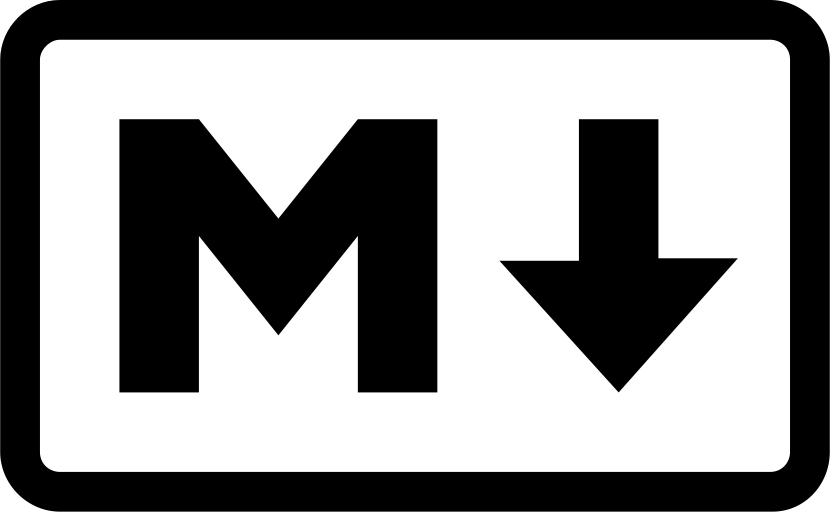

# Mi portafolio

Trabajos del curso Diseño de Interfaces de Programacion Avanzado.

## Sobre mi

Estudiante de Diseño y Desarrollo de Software en Tecsup.

## Contenido

### Trabajos del modulo 1

## Herramientas que uso

- **Git** para el control de versiones
- **GitHub** para repositorio remoto
- *Visual Studio Code* como editor

## Pasos para clonar este proyecto

1. Copiar la direccion desde el boton Code
2. Ejecutar git clone con esa direccion
3. Entrar a la carpeta con cd

## Mi avance del modulo

- [x] Laboratorio 01: Git basico
- [x] Laboratorio 03: Trabajo colaborativo
- [ ] Laboratorio 04: Markdown

## Enlaces utiles

- [Guia oficial de Markdown] (https://www.markdownguide.org/)
- [Mi perfil de GitHub] (https://github.com/ericDeveloper-Tecsup)

## Captura de mi trabajo



## Comandos que mas uso

para ver el estado del proyecto uso `git status`.

```bash
git add .
git commit -m "Actualiza el Readme"
git push origin main

| Comando | Que hace |
|---------|----------|
| git add | Prepara los cambios |
| git commit | Guarda la version |
| git push | sube los cambios al remoto |

> Documentar es parte del trabajo, no un extra al final.